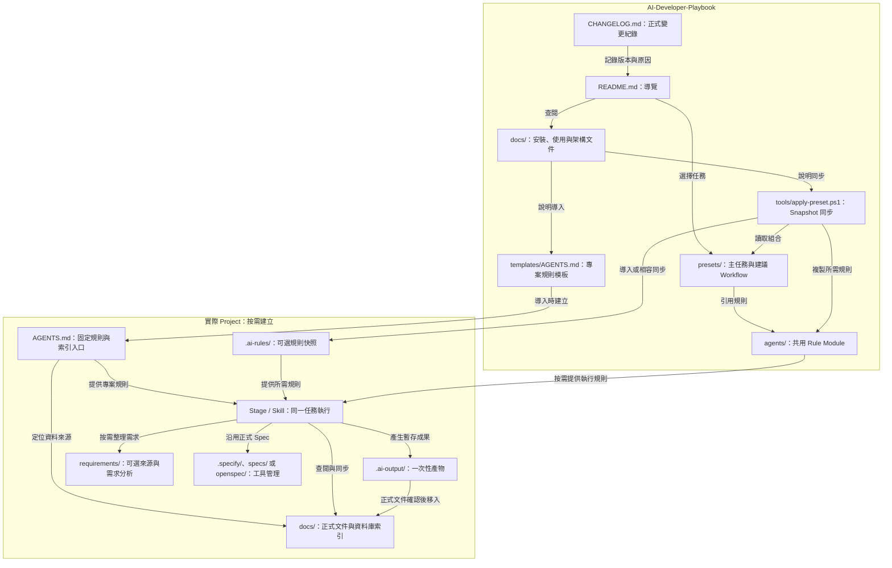

# Repository 結構關係圖

本圖呈現 Playbook 各資料夾的責任，以及規則如何用於實際 Project。方框內標示的 Project 檔案與資料夾屬於目標專案，依使用方式建立，不是本 Repository 內的實體目錄。

## 目錄責任與邊界

| 位置 | 保存內容 | 與其他位置的關係 |
| --- | --- | --- |
| Playbook `README.md` | 整體導覽與核心模型 | 連到詳細文件與圖表 |
| Playbook `presets/` | 主任務與建議流程 | 引用 `agents/`，可直接指定 Stage |
| Playbook `agents/` | 共用規則、Diagram Profile 與資料存取規範 | Stage 按需使用，避免規則複製 |
| Playbook `docs/` | 安裝、使用、架構、流程與規範 | 說明共用方法，不保存公司專有內容 |
| Playbook `templates/` | Project 規則模板 | 導入時建立 Project AGENTS.md；既有規則沿用 |
| Playbook `tools/` | 安裝、同步與 Snapshot 相容工具 | 不主導同一任務內的 Stage 切換 |
| Playbook `CHANGELOG.md` | 正式變更、目的與原因 | 與 Git commit 一起保存版本紀錄 |
| Project `AGENTS.md` | 專案固定規則與資料庫索引入口 | 定位 Project 文件；Stage 先讀 |
| Project `.ai-rules/` | 可選共用規則快照 | 可重建，不保存正式資料庫索引 |
| Project `docs/` | 已確認文件與資料存取索引 | 索引分總入口、各資料庫與必要跨資料庫流程 |
| Project `.ai-output/` | 一次性報告、圖、資料與暫存 | 不作為正式 Spec 的唯一依據 |
| Project `requirements/` | 可選原始來源、分析與需求圖 | 補足 Spec 前的需求理解，不重建正式 Spec |
| Project `.specify/`、`specs/`、`openspec/` | 選用 Spec Engine 的設定與正式產物 | 由對應工具依版本與設定管理，不要求全部建立 |

圖中的箭頭標示引用、導入、查閱或產出關係；工作先後順序請見 [Playbook 工作流程](Workflow.md)。Stage / Skill 是執行概念，不代表新增一個 `skills/` 目錄。

## 來源

- [README](../README.md)、[Architecture Definitions](Architecture_Definitions.md)：目錄責任、Runtime 與產物邊界。
- [Preset Application](Preset_Application.md)、[Stage Execution](Stage_Execution.md)：Preset、Stage 與 Snapshot 的關係。
- [Project 模板](../templates/AGENTS.md)、[Tools](../tools/README.md)：Project 導入與規則同步。
- [Spec Strategy](Spec_Strategy.md)：Requirement Workspace 與成熟工具的資料夾責任。
- [Data Access](Data_Access.md)：Project 資料庫索引位置與同步規則。
