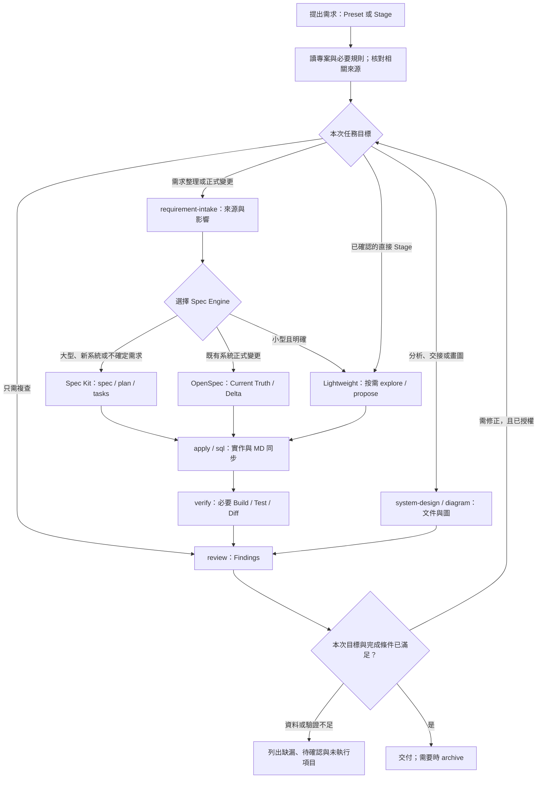

# Playbook 現行工作流程

本圖整理目前 Playbook 的日常執行流程。Preset 提供主任務與建議順序，也可以直接指定 Stage；依本次需求選擇入口，不必每次走完整流程。

## 圖中步驟的執行條件

- **需求先分流：**大型、新系統或不確定需求優先 Spec Kit；既有系統正式變更優先 OpenSpec；小型且明確變更採 Lightweight Flow。不要求兩套 Spec Engine 同時執行，也不複製它們的正式產物。Requirement Workspace 只在需要時保存來源與分析；已完成需求整理時沿用既有結論。
- **Stage 入口可調整：**已有 Findings、Spec 或 Diff 時直接沿用，只補讀必要來源。分析任務可在取得 Findings 後交付；圖中的文件與 Review 路徑依需求選用。
- **規則按需載入：**Stage 引用既有 Rule Module；畫圖時選 Diagram Profile，Modifier 調整本次輸出。需要時查 Registry 與 Data References。
- **資料存取先核對：**由 Project 總索引與各資料庫索引，定位 ContextProcedures 的介面／實作、參數、Result，以及 SP／Function 本體與必要 Table／View；核對後才決定沿用、最小修改、EF Core 完整查詢或新增 SP。MD 負責定位，程式與 SQL 負責判定；來源缺漏時只進行不依賴缺漏資訊的工作。
- **效能與多資料庫：**阻擋逐筆補查、完整候選取回後篩選，以及可由資料庫完成卻拆成多次查詢的 C# 拼接。必要的跨資料庫 Service 整合須限定範圍、批次取得，記錄理由、交易與一致性。
- **程式與文件一起同步：**產生、重新產生或修改資料存取程式時，同一變更更新所屬資料庫 MD；跨資料庫流程有異動才同步相關流程文件。此規範尚未提供自動索引生成器。
- **Verify / Review：**驗證與本次變更相關的結果、權限及查詢成本；Review 以 Diff 或指定產物為主。已證實的禁止模式列為必修，未修正不得判定通過；無環境或來源不足時明列限制。純 Review 不自行修改。
- **歸檔與輸出：**archive 只沿用 Spec、Tasks、Diff 與 Build / Test Result。一次性產物集中於 `.ai-output/`；正式文件確認後放入 `docs/`。

同一任務切換 Stage 保留 Context，不重掃 Repository，也不重新執行 PowerShell。第一次導入、特殊同步或舊 Snapshot 相容模式請參閱 [Installation](Installation.md)。

## 來源

本圖依以下現行文件整理；詳細規則與完成條件以來源文件為準。

- [Spec Strategy](Spec_Strategy.md) 與 [Requirement Intake](../presets/requirement-intake.md)：需求入口與 Spec Engine 分流。
- [Usage](Usage.md)：日常入口、流程選擇與 Stage 串接。
- [Stage Execution](Stage_Execution.md)：同一任務的 Context 延續與規則載入。
- [Architecture Definitions](Architecture_Definitions.md)：Preset、Workflow、Stage、Rule Module、Profile、Modifier 與產物責任。
- [Data Access](Data_Access.md) 與 [Data Access Rules](../agents/data-access.md)：資料存取前置檢查、效能阻擋、多資料庫及 MD 同步。
- [OPSX Workflow](OPSX_Workflow.md) 與 [Archive Rules](../agents/archive.md)：變更規格、實作與歸檔。
- [System Design Preset](../presets/system-design.md) 與 [Diagramming Rules](../agents/diagramming.md)：分析文件範圍與 Mermaid 圖表規則。
